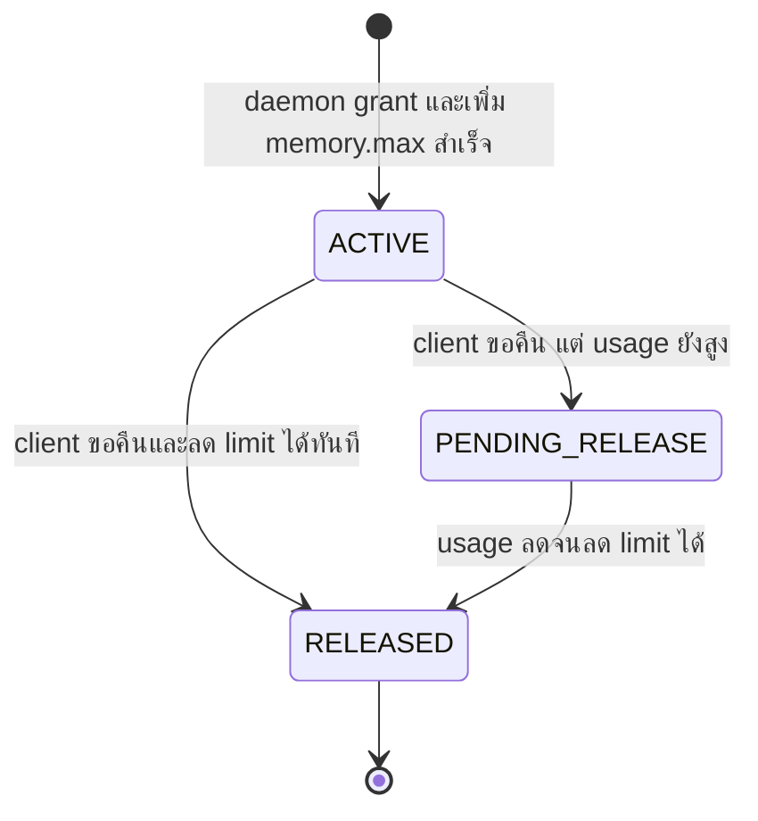
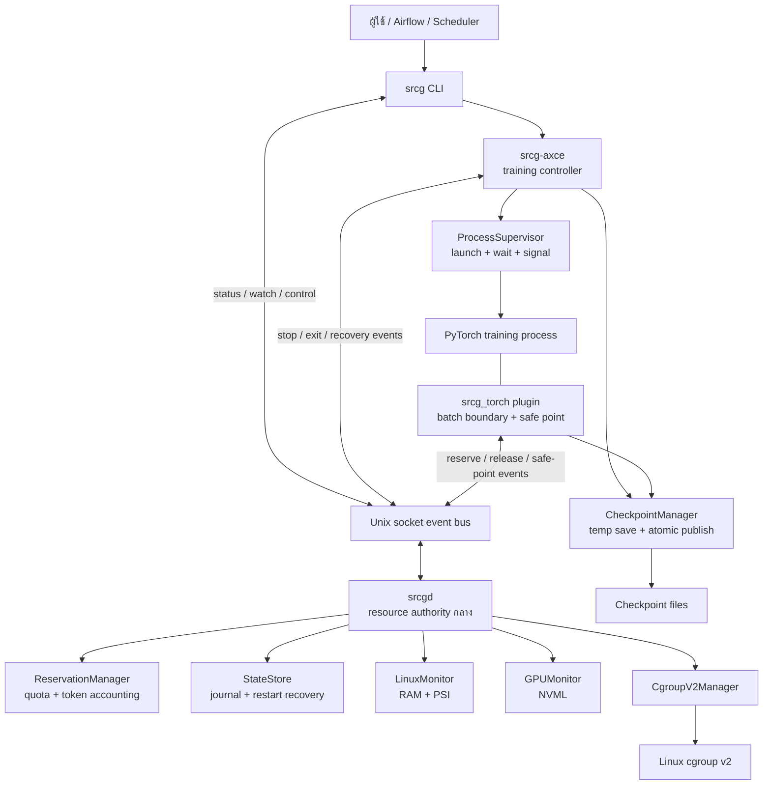
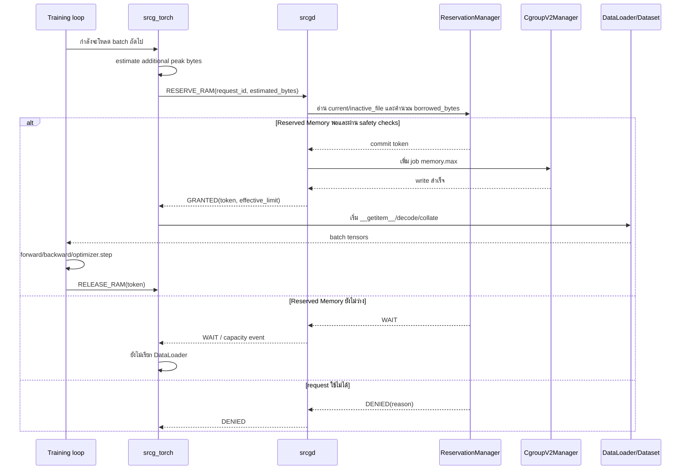
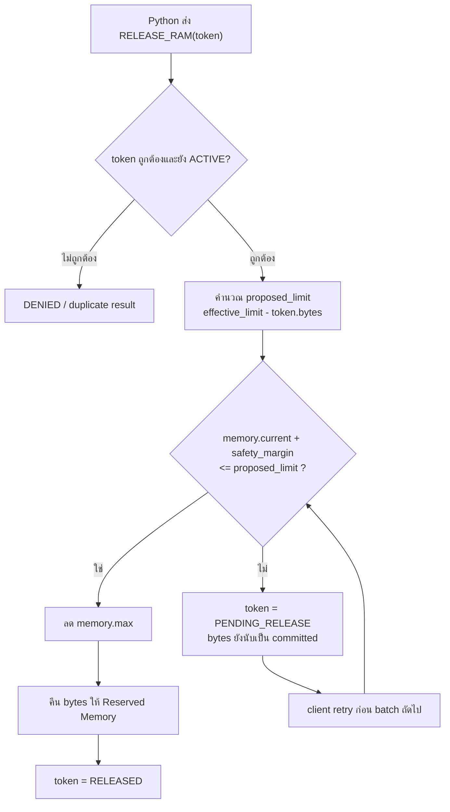
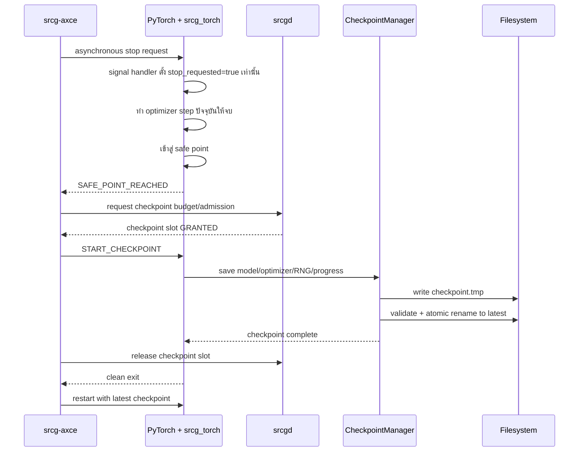
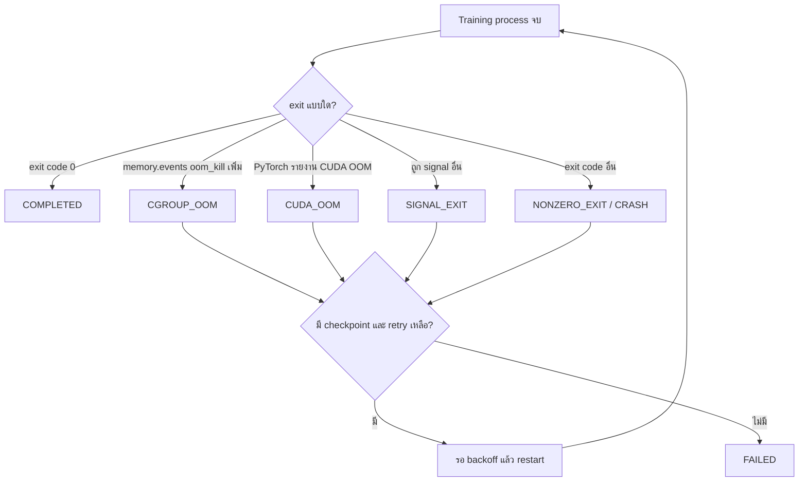
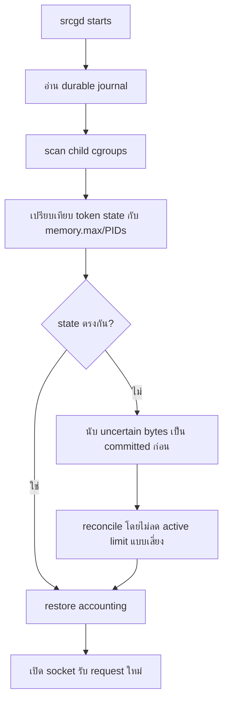

# SRCG: ภาพรวมระบบ, Flow, Modules และคำศัพท์

เอกสารนี้อธิบาย SRCG ตั้งแต่ภาพใหญ่ไปถึงแต่ละ module โดยใช้ภาษาที่ไม่ต้องรู้
cgroup หรือระบบ distributed มาก่อน

Glossary ด้านล่างบอกความหมายของคำ ส่วนที่มาว่าคำหรือกลไกนั้นเกิดจาก requirement
หรือ failure ใด และ implement แล้วหรือยัง อยู่ที่
[decision-trace.md](decision-trace.md) ห้ามตีความคำที่ติด `[PROPOSED]` ในเอกสารนั้น
ว่าเป็น API ปัจจุบัน

> สำคัญ: แผนภาพส่วน "เมื่อโปรเจกต์เสร็จ" คือ target architecture ไม่ได้แปลว่า
> ทุกกล่อง implement แล้ว ตารางสถานะและป้าย `[M1]`, `[M2]` จะแยกของที่มีแล้วออกจาก
> ของที่จะสร้าง

## 1. SRCG คืออะไรในหนึ่งประโยค

SRCG คือ resource manager บน Linux เครื่องเดียวที่ครอบ PyTorch training jobs,
จำกัด CPU RAM ของแต่ละ job, ให้ jobs ยืม RAM ส่วนกลางเฉพาะตอนที่ต้องโหลด batch,
และในระยะถัดไปสามารถหยุดที่ safe point, save checkpoint และ restart ได้

SRCG ไม่ใช่ model trainer และไม่ได้แทน PyTorch ผู้ใช้ยังเลือก model, batch size,
epoch, optimizer และ learning rate ตามปกติ

## คำที่ต้องรู้ก่อนอ่าน: Reservation token คืออะไร

`Reservation token` คือ **เลขใบรับสิทธิ์การยืม RAM จาก Reserved Memory หนึ่งก้อน** ที่
`srcgd` สร้างเมื่ออนุมัติคำขอ และส่งกลับให้ training process เก็บไว้สำหรับขอคืน
สิทธิ์ก้อนเดิมภายหลัง

Token ไม่ใช่ RAM, ไม่ใช่ password, ไม่ใช่ PID และไม่ใช่ cgroup มันเป็น identifier
เช่น `rsv-91` ที่ชี้ไปยัง record ใน daemon:

```text
token:       rsv-91
owner_job:   job-A
request_id:  request-17
estimated:   700 MiB
borrowed:    180 MiB
state:       ACTIVE
```

ตัวอย่างตั้งแต่ต้นจนจบ:

```text
1. Job A มี base quota 3.5 GiB
2. ก่อนโหลด batch, Job A estimate ว่าอาจใช้เพิ่ม 700 MiB ด้วย request-17
3. Job A มี headroom 520 MiB daemon จึงยืมจริง 180 MiB และเพิ่ม memory.max
4. daemon ตอบ GRANTED(token=rsv-91)
5. Job A โหลดและ train batch
6. Job A ส่ง RELEASE_RAM(token=rsv-91)
7. daemon ตรวจว่าลด limit ได้อย่างปลอดภัย แล้วคืน 180 MiB ให้ Reserved Memory
```

Lifecycle ของ token:



เหตุผลที่ต้องมี token แทนการสั่ง `release(700 MiB)` เฉย ๆ:

- daemon รู้ว่ากำลังคืน reservation ก้อนไหนและเป็นของ job ใด
- release ซ้ำด้วย token เดิมจะไม่คืน Reserved Memory ซ้ำสองครั้ง
- daemon restart แล้วตามสิทธิ์ที่ยังค้างจาก journal ได้
- ถ้ามีหลาย reservations ขนาดเท่ากัน จะไม่สับสนว่าคืนก้อนไหน

`Request ID` กับ token เป็นคนละตัว:

- `request_id` ถูกสร้างโดย client ก่อนส่งคำขอ ใช้ retry คำขอเดิมโดยไม่ grant ซ้ำ
- `token` ถูกสร้างโดย daemon สำหรับ reservation ที่อนุมัติแล้ว ใช้ติดตามและ release

Python จะถือ token เป็น object ภายใน plugin ผู้ใช้ทั่วไปไม่ต้องสร้างหรือพิมพ์ token
เอง

## 2. สถานะของแต่ละ Milestone

| Milestone | เป้าหมาย | สถานะ |
| --- | --- | --- |
| M1 | Fixed CPU RAM quota, process supervision, monitoring และ cleanup | มี implementation แล้ว |
| M2 | Shared Reserved Memory accounting, Unix IPC และ safe release | มี functional foreground manager; durable journal ยังไม่มี |
| M3 | PyTorch batch-aware integration + COCO/Lung demo | มี prototype และ real-cgroup/GPU results แล้ว |
| M4 | Checkpoint budget, cooperative stop และ restart/recovery | periodic save กับ checkpoint admission ใช้ได้; CUDA OOM/cross-boot recovery ยังไม่ครบ |
| M5 | Fixed PyTorch VRAM quota, CUDA/NVML monitoring และ CUDA OOM policy | ยังไม่ทำ |
| M6 | Optional predictive warning, evaluation และ scheduler integrations | ยังไม่ทำ |

M2–M3 ทำ RAM reserve/release ครบ end-to-end แล้ว แต่ยังไม่รวม automatic batch
reduction, multiprocessing prefetch reservation หรือ VRAM borrowing

## 3. ภาพรวมโปรเจกต์เมื่อเสร็จ



ใจกลางของระบบคือ `srcgd` เพราะการยืม Reserved Memory ของหลาย jobs ต้องมีผู้
ตัดสินใจหนึ่งตัว ถ้าแต่ละ `srcg run` ตัดสินใจเอง ทั้งสอง process อาจเห็น capacity
ก้อนเดียวกันและอนุมัติพร้อมกันจน accounting เกิน Reserved Memory ได้

## 4. ใครทำงานอยู่ที่ไหน

```text
Linux host
│
├── srcg serve                    shared manager กลาง (logical srcgd)
│   ├── ReservationManager        ตัดสิน grant/deny/wait
│   ├── StateStore                [future] journal เพื่อ recover manager crash
│   ├── Reservation IPC           รับ/ส่ง Unix-socket messages + event log
│   ├── LinuxMonitor              อ่าน host RAM และ PSI
│   ├── GPUMonitor                อ่าน GPU ผ่าน NVML ในระยะถัดไป
│   └── CgroupV2Manager           อ่าน/เปลี่ยน cgroup limits
│
├── srcg run                      foreground supervisor หนึ่งตัวต่อหนึ่ง job
│   └── ProcessSupervisor         fork, attach, exec, signal และ waitpid
│       └── Python/PyTorch
│           ├── srcg_torch        plugin ที่รู้ batch boundary/safe point
│           └── DataLoader workers
│
└── srcg-axce                     [M4 target] controller แยกสำหรับ recovery
```

`srcg run` ต้องอยู่ foreground เพื่อให้ stdout/stderr ของ terminal เป็นของ training
เหมือนรัน Python ปกติ ส่วน `srcg serve` เป็น foreground shared authority ที่ดูหลาย
jobs พร้อมกัน ปัจจุบันผู้ใช้หรือ service manager ต้องดูแล lifecycle ของ process นี้

## 5. Proposed source tree

Tree นี้แสดง module ทางตรรกะ ไม่ได้บังคับให้ย้ายไฟล์ M1 ที่มีอยู่โดยไม่จำเป็น

```text
NVML-test/
│
├── srcg_cli.cpp                         [M1] CLI: init/run/status/cleanup
├── srcg_daemon.h/.cpp                   [M1] foreground orchestration เดิม
├── process_supervisor.h/.cpp            [M1] fork/exec/wait/signal
├── cgroup_manager.h/.cpp                [M1] cgroup v2 operations
├── linux_monitor.h/.cpp                 [M1] host/process RAM และ PSI
├── thread_manager.h/.cpp                [M1] C++ worker thread pool
├── memory_size.h/.cpp                   [M1] แปลง GiB/GB เป็น bytes
├── gpu_monitor.h/.cpp                   [M1 optional] NVML reader
│
├── reservation_ipc.h/.cpp               [M2] shared manager + Unix socket IPC
├── reservation_manager.h/.cpp           [M2] Reserved Memory/job/token accounting
├── state_store.h/.cpp                   [future] journal และ reconciliation
├── event_bus.h/.cpp                     [future] status/watch/capacity events
│
├── srcg_torch/
│   ├── client.py                        [M3] Unix socket reservation client
│   ├── checkpoint.py                    [early M4] atomic checkpoint store
│   └── session.py                       [early M4] cooperative safe points
│
├── axce/
│   ├── controller.h/.cpp                [M4 target] stop/restart state machine
│   ├── checkpoint_manager.py            [M4 target] checkpoint admission
│   └── restart_policy.h/.cpp             [M4 target] retry limit/backoff
│
├── benchmarks/dataloader_policy/
│   ├── train.py                         [M1] COCO/Lung real-data workload
│   └── test_planning.py                 [M1] batch-plan tests
│
└── tests/
    ├── reservation_manager_tests.cpp    [M2]
    ├── reservation_ipc_tests.cpp         [M2]
    ├── test_reservation_client.py        [M3]
    ├── test_checkpoint.py                [early M4]
    └── recovery_tests.*                  [M4 target]
```

`pytorch_plugin.h` ที่อยู่ใน repository ตอนนี้เป็นเพียงไฟล์ว่าง ไม่ใช่จุดเชื่อม
ที่ใช้งานจริง การเชื่อม training ใน M3 อยู่ที่ `srcg_torch/client.py` และ
worker-side `ReservedBatchDataset` ใน benchmark ส่วน `PlanningBatchSampler` ใช้
กับ debug/exact checkpoint cursor เท่านั้น resource authority/accounting ยังอยู่ใน C++

## 6. หน้าที่ของแต่ละ module

### `srcg` CLI

หน้าที่:

- รับคำสั่งจากผู้ใช้ เช่น `init`, `run`, `status`, `watch`, `stop`
- validate argument และหน่วย memory
- ส่ง control request ไป `srcgd`
- `run` รอผลของ training แล้วคืน exit code ให้ shell

ไม่ควรทำ:

- เก็บ global Reserved Memory state ไว้ใน process ตัวเอง
- ตัดสิน reserve ของหลาย jobs เอง
- พิมพ์ telemetry ปนกับ stdout/stderr ของ training

### `srcg serve` / logical `srcgd`

shared C++ manager และเป็น source of authority ของ resource state ใน process ที่
กำลังรันอยู่ ปัจจุบันเป็น foreground command ยังไม่มี systemd unit และ durable
journal

หน้าที่:

- รับ IPC จาก CLI, PyTorch plugin และ `srcg-axce`
- serialize การขอ reserve พร้อมกัน
- สั่งเปลี่ยน `memory.max`
- ตรวจ host state และ cgroup state
- เขียน reservation event log
- reconcile stale job account เมื่อ supervisor รอบใหม่ติดต่อเข้ามา

การเขียน durable journal และ reconcile หลัง manager process restart ยังเป็นงาน
ถัดไป

### `ReservationManager`

เป็น accounting engine ซึ่งไม่ควรรู้รายละเอียด socket หรือ PyTorch

Input ตัวอย่าง:

```text
reserve(job-A, request-17, 700 MiB)
release(token-91)
```

Output ตัวอย่าง:

```text
GRANTED(token-91, effective_limit=4.2 GiB)
WAIT(queue_position=2)
DENIED(reason=job_not_authorized)
PENDING_RELEASE(token-91)
RELEASED(token-91)
```

### `CgroupV2Manager`

adapter ระหว่าง SRCG กับ Linux kernel

หน้าที่:

- สร้าง parent/job cgroups
- อ่านและเขียน `memory.max`, `memory.swap.max`
- attach PID เข้า `cgroup.procs`
- อ่าน current/peak/events/populated
- ลบเฉพาะ cgroup ที่ไม่มี process

ตัวนี้บังคับ CPU RAM ได้ แต่ไม่ควบคุม GPU VRAM

### `ProcessSupervisor`

หน้าที่:

- fork child
- หยุด child ที่ pipe barrier
- attach child เข้า cgroup ก่อน `exec`
- forward termination signals
- รอ process ด้วย `waitpid`
- คืน exit code และ OOM classification

### `LinuxMonitor`

อ่านข้อมูลเท่านั้น ไม่ใช่ allocator:

- `/proc/meminfo`: `MemTotal`, `MemAvailable`, swap
- `/proc/pressure/memory`: memory PSI
- `/proc/<pid>/status`: process RSS/virtual size

### `GPUMonitor`

อ่าน NVML เพื่อดู global GPU state เช่น VRAM usage, utilization และ temperature
มันเป็น observer ไม่ใช่ hard VRAM isolator

### `ThreadManager`

C++ thread pool สำหรับงานพร้อมกัน เช่น IPC clients, monitoring และ pending-release
retry มันไม่ใช่ตัวจัดการ DataLoader workers

### `StateStore`

เก็บ journal ของ jobs, requests และ reservation tokens เพื่อให้ daemon restart แล้ว
ไม่ลืมว่า pool ส่วนไหนถูก commit ไปแล้ว

cgroup filesystem บอก limit ปัจจุบันได้ แต่บอกไม่ได้ว่าแต่ละ byte มาจาก token ไหน
จึงต้องมีทั้ง kernel state และ journal

### `EventBus`

ช่องทาง Unix domain socket ที่ทำให้ components มองเห็นเหตุการณ์เดียวกัน เช่น:

```text
JOB_REGISTERED
RESERVATION_QUEUED
RESERVATION_GRANTED
LIMIT_CHANGED
RESERVATION_RELEASED
JOB_EXITED
```

Job A มองเห็นว่า capacity เปลี่ยนหรือคำขออยู่ใน queue แต่ไม่มีสิทธิ์ไปแก้ quota ของ
Job B โดยตรง

### `srcg_torch`

Python plugin ที่อยู่ภายใน training process เพราะฝั่งนี้เท่านั้นที่รู้ว่า:

- batch ถัดไปคือ indices ใด
- DataLoader กำลังจะโหลดเมื่อไร
- optimizer step จบสมบูรณ์แล้วหรือยัง
- ตอนไหนเป็น safe point สำหรับ stop/checkpoint

plugin ไม่เป็นผู้อนุมัติ memory มันส่งคำขอไป C++ daemon แล้วรอผล

### `BatchEstimator`

ประมาณ peak RAM ที่จะเพิ่มจาก batch ถัดไป โดยพิจารณา decoded data, resize/collate,
NumPy/Python objects, tensors, prefetch และ pinned memory

estimate เป็นค่าประมาณพร้อม safety factor ไม่ใช่คำรับประกันว่าจะใช้เท่านั้นพอดี

### `srcg-axce`

training controller ใน M4

หน้าที่:

- ตัดสิน WAIT, checkpoint, stop, restart และ retry limit
- ขอให้ training หยุดแบบ cooperative
- เลือก checkpoint ล่าสุดที่สมบูรณ์
- เปลี่ยน run state เป็น COMPLETED หรือ FAILED

daemon จัดการ resource ส่วน AXCE จัดการ training recovery policy สองหน้าที่นี้ไม่ควร
ปนกัน

### `CheckpointManager`

ทำงานเมื่อ training ถึง safe point:

1. save ลง temporary file
2. flush/validate ว่า save สำเร็จ
3. publish ให้เป็น latest checkpoint แบบ atomic
4. ลบหรือเก็บไฟล์เก่าตาม retention policy

ถ้า save ใหม่ล้มเหลว checkpoint เก่าที่ยังสมบูรณ์ต้องไม่ถูก overwrite

## 7. ใครเป็นเจ้าของ state อะไร

| State | Owner | Source of truth |
| --- | --- | --- |
| Parent hard RAM limit | Linux kernel | parent `memory.max` |
| Job current/peak RAM | Linux kernel | job `memory.current`/`memory.peak` |
| PID membership | Linux kernel | `cgroup.procs` และ `/proc/<pid>/cgroup` |
| Base quota และ borrowed accounting | `srcgd` | durable StateStore + reconciliation |
| Reservation token state | `srcgd` | durable StateStore |
| Batch indices และ safe point | PyTorch process | `srcg_torch`/training loop |
| Model/optimizer state | PyTorch process | memory และ checkpoint file |
| Restart count/backoff | `srcg-axce` | controller state |
| GPU global telemetry | NVIDIA driver | NVML |

การกำหนด owner ชัดเจนช่วยป้องกันสอง components เขียน state เดียวกันพร้อมกัน

## 8. Flow ปัจจุบัน: M1 fixed quota

```mermaid
sequenceDiagram
    actor U as User
    participant CLI as srcg run
    participant CG as CgroupV2Manager
    participant PS as ProcessSupervisor
    participant P as Python/PyTorch
    participant K as Linux kernel

    U->>CLI: run --job A --memory 6GiB -- python train.py
    CLI->>CG: create job-A, memory.max=6GiB
    CLI->>PS: launch command
    PS->>P: fork; child waits at barrier
    PS->>CG: attach child PID
    CG->>K: write PID to cgroup.procs
    PS->>P: release barrier; exec Python
    P->>P: DataLoader + training
    P-->>PS: exit
    PS->>K: read OOM/exit state
    CLI->>CG: cleanup when process tree is empty
    CLI-->>U: return training exit code
```

M1 limit คงที่ทั้ง run และไม่มีการยืม Reserved Memory ระหว่าง batch

## 9. Flow M2–M3: reserve ก่อนโหลด batch



Invariant สำคัญที่สุดคือ `memory.max` ต้องเพิ่มสำเร็จก่อน daemon ตอบ `GRANTED`
และ DataLoader ต้องยังไม่โหลด sample ก่อนรับ `GRANTED`

## 10. Flow M2: release และ pending release



`RELEASE_RAM` เป็นคำขอคืนสิทธิ์ ไม่ได้แปลว่า memory ถูกคืนทันที Python, NumPy หรือ
page cache อาจยังถือ memory อยู่ daemon จึงต้องดู usage จริงก่อนลด hard limit

## 11. Flow M2: jobs หลายตัวใช้ bus ร่วมกัน

ตัวอย่าง Reserved Memory มี 2 GiB:

```mermaid
sequenceDiagram
    participant A as Job A
    participant D as srcgd / Reserved 2GiB
    participant B as Job B

    A->>D: reserve 1.5GiB
    D-->>A: GRANTED; available=0.5GiB
    B->>D: reserve 1.5GiB
    D-->>B: WAIT; reason=Reserved Memory ไม่พอ
    Note over B: B ยังไม่โหลด batch
    A->>D: release token
    Note over D: ลด A limit และคืน Reserved Memory เมื่อปลอดภัย
    B->>D: retry request ID เดิม
    D-->>B: GRANTED
    B->>B: เริ่มโหลด batch
```

นี่คือความหมายของ resource orchestration ระหว่าง neighbors: jobs ไม่สั่งกันเอง
แต่ประสานผ่าน daemon และ Reserved Memory ledger เดียวกัน ปัจจุบัน manager เก็บ
pending requests แบบ FIFO และ client poll ด้วย request ID เดิม; event subscription
และการส่ง queue position กลับ client ยังเป็นงานถัดไป

## 12. Flow M4: cooperative stop และ checkpoint



Signal handler ห้าม save checkpoint เอง เพราะ PyTorch/CUDA operations ไม่ปลอดภัย
ใน asynchronous signal handler หน้าที่ของ signal คือแค่ตั้ง flag

## 13. Flow เมื่อ process จบหรือพัง



M1 ทำ classification ฝั่ง CPU cgroup ได้แล้ว แต่ recovery path ในแผนภาพเป็น M4
ถ้า process ถูก OOM kill ไปแล้วจะ save checkpoint ใหม่ไม่ทัน ต้องใช้ checkpoint
สมบูรณ์ที่สร้างไว้ก่อนหน้า

## 14. Flow เมื่อ `srcgd` restart



หลักคือหลัง crash ต้องไม่มอง Reserved Memory ว่างเกินจริง เพราะจะ grant ซ้ำให้ job อื่น

## 15. Memory model และสมการ

### ระดับ host และ parent

ตัวอย่างเชิงแนวคิด:

```text
Host RAM total                       16 GiB
├── พื้นที่นอก SRCG / host headroom   4 GiB
└── SRCG parent memory.max            12 GiB
    ├── active job base quotas         8 GiB
    ├── Reserved Memory                3 GiB
    └── checkpoint safety budget       1 GiB
```

Invariant ตอน configuration/admission:

```text
parent_limit <= MemTotal - host_headroom
parent_limit <= each_finite_ancestor_memory.max - host_headroom

base_committed
+ reserved_memory_capacity
+ checkpoint_budget
<= parent_limit
```

`host_headroom` ไม่ได้ allocate หรือ lock RAM 4 GiB ไว้จริง มันเป็น policy ที่จำกัด
ว่า SRCG parent มีเพดานได้มากเท่าไร

ตอน reserve ตรวจ dynamic state:

```text
effective_available = min(
    host MemAvailable,
    each finite ancestor (memory.max - memory.current)
)

effective_available >= requested_additional_bytes + host_headroom
```

ทั้ง host และ ancestor available นับ usage ปัจจุบันไปแล้ว จึงลบเฉพาะ memory ที่
คาดว่าจะเพิ่มในอนาคต ไม่เอา base quota มาลบซ้ำ การอ่าน ancestor ทำให้ container
ที่ limit 5 GiB ไม่ถูกประเมินจาก RAM ทั้ง host

### ระดับ job

```text
effective_limit = base_quota + borrowed_bytes

reserved_memory_available = reserved_memory_capacity - reserved_memory_committed

protected_current = max(0, memory.current - inactive_file)

borrow_needed = max(
    0,
    protected_current + estimated_allocation - effective_limit
)
```

ตัวอย่าง:

```text
Job A base_quota         = 3.5 GiB
Estimated allocation     = 0.7 GiB
Existing usable headroom = 0.5 GiB
Token borrowed_bytes     = 0.2 GiB
Job A effective_limit    = 3.7 GiB
```

เมื่อ grant สำเร็จ daemon เขียน `3.7 GiB` ลง `job-A/memory.max` แต่ไม่ได้ทำให้
process ใช้ RAM 3.7 GiB ทันที Host-headroom check ยังใช้ estimate 0.7 GiB เต็มก้อน

## 16. สามคำที่ห้ามใช้แทนกัน

| คำ | ความหมาย | มี RAM ถูกใช้จริงหรือยัง |
| --- | --- | --- |
| Quota/limit | เพดานสูงสุดที่อนุญาต เช่น `memory.max=4GiB` | ยังไม่จำเป็น |
| Accounting reservation | daemon กันสิทธิ์จาก Reserved Memory ให้ token หนึ่ง | ยังไม่จำเป็น |
| Allocation/usage | process ขอ page และเขียนข้อมูลจริงจน kernel charge memory | ใช้จริงแล้ว |

ดังนั้น `reserve_ram(700MiB)` หมายถึงจองสิทธิ์และขยายเพดาน ไม่ใช่สั่ง Linux ให้
allocate RAM 700 MiB ทันที

## 17. Glossary: คำศัพท์ระบบและ Linux

### Process

โปรแกรมหนึ่ง instance ที่กำลังทำงาน มีหมายเลข `PID` เช่น Python main process

### PID

Process identifier หมายเลขที่ Linux ใช้อ้างถึง process

### Parent/child process

process หนึ่งสร้างอีก process ผ่าน `fork`/`spawn` ตัวสร้างคือ parent ตัวที่ถูกสร้าง
คือ child DataLoader worker เป็น child ของ Python training process

### Process tree

Python main process รวม descendants เช่น DataLoader workers และ subprocesses

### cgroup v2

กลไกของ Linux kernel สำหรับจัดกลุ่ม processes และวัด/จำกัด resource ของทั้งกลุ่ม

### Parent cgroup

cgroup ระดับรวมของ SRCG เช่น `/sys/fs/cgroup/srcg` ค่า `memory.max` ตรงนี้จำกัด
actual CPU RAM usage รวมของทุก jobs ใต้ parent

### Job cgroup

cgroup ของ training job เดียว เช่น `/sys/fs/cgroup/srcg/lung-a`

### `memory.max`

hard CPU memory ceiling ของ cgroup หาก usage ขยายต่อไม่ได้ kernel อาจ reclaim หรือ
OOM-kill process ในกลุ่ม

### `memory.current`

memory ที่ kernel charge ให้ cgroup อยู่ตอนอ่านค่า รวม anonymous memory และ cache
บางประเภท

### `memory.peak`

ค่าสูงสุดของ `memory.current` ที่เคยเกิดในอายุ cgroup

### `memory.events`

counters จาก kernel เช่นแตะ limit, เกิด OOM หรือมี process ถูก OOM-kill

### `memory.oom.group`

policy ให้ kernel มอง workload ใน cgroup เป็นกลุ่มเมื่อจัดการ OOM เพื่อลดกรณี main
process ตายแต่ workers บางตัวรอด

### `cgroup.procs`

รายชื่อ PIDs ที่อยู่ใน cgroup การเขียน PID ลงไฟล์นี้คือการย้าย process เข้ากลุ่ม

### `populated`

ค่า liveness จาก `cgroup.events`; เป็น 1 เมื่อ cgroup หรือ descendants ยังมี process

### Page cache

RAM ที่ Linux ใช้ cache ข้อมูลไฟล์ เช่น dataset ที่อ่านมา จึงอาจถูกนับใน cgroup แม้
ไม่ใช่ Tensor

### `inactive_file`

ส่วนของ file-backed page cache ที่ kernel จัดไว้ใน inactive list SRCG Phase 2
ถือว่าส่วนนี้ reclaim ได้และจึงไม่นำไปคำนวณ protected working set แต่มันยังนับ
ใน `memory.current` และยังถูกบังคับด้วย `memory.max`

### Swap

พื้นที่สำรองบน disk/zram ที่ Linux ใช้ย้าย memory pages ออกจาก physical RAM
`--swap 0` หมายถึง job ใช้ swap ไม่ได้

### `MemAvailable`

ค่าที่ kernel ประเมินว่า host ยังมี RAM พร้อมใช้ได้โดยไม่ต้อง swap หนัก ไม่เท่ากับ
`MemFree` เพราะรวม cache ที่ reclaim ได้บางส่วน

### PSI

Pressure Stall Information วัดสัดส่วนเวลาที่ processes ต้องหยุดรอเพราะ resource
pressure ใช้เป็น telemetry/early warning ไม่ใช่ hard quota

### RSS

Resident Set Size คือ physical RAM ที่ process หนึ่งมี resident อยู่ แต่ไม่ใช่ยอด
ทั้ง cgroup และจัดการ shared pages ได้ไม่สมบูรณ์เท่า cgroup counters

### VmSize

ขนาด virtual address space ที่ process map ไว้ ไม่ใช่ RAM จริง จึงห้ามใช้เป็น hard
admission rule

## 18. Glossary: คำศัพท์ resource orchestration

### Resource Manager

component ที่ถือ policy และตัดสินว่า job ใดใช้ resource ได้เท่าไร ใน SRCG คือ
`srcgd` ร่วมกับ `ReservationManager`

### Base quota

เพดาน RAM เริ่มต้นที่ job มีตลอด run และเป็น `memory.max` ก่อนยืม Reserved Memory

### Reserved Memory

capacity ส่วนกลางที่กันไว้ใน parent accounting เพื่อให้ jobs ยืมชั่วคราวเมื่อ batch
ต้องใช้ peak RAM มากกว่า base ชื่อเดิม `batch pool` หมายถึงสิ่งเดียวกัน แต่เอกสาร
และ public API ใช้คำว่า Reserved Memory เท่านั้น

### Borrowed bytes

ยอด accounting ที่ job ยืมจาก Reserved Memory อยู่ในขณะนั้น

### Effective limit

เพดานปัจจุบันของ job:

```text
base quota + borrowed bytes
```

### Committed

capacity ที่ daemon ให้สิทธิ์ไปแล้ว แม้ process อาจยังไม่ได้ allocate memory จริง

### Admission

ขั้นตอนตรวจ request ก่อนอนุมัติ เช่น Reserved Memory พอไหม, caller มีสิทธิ์ไหม และ limit ใหม่
ยังอยู่ใต้ parent หรือไม่

### Grant / `GRANTED`

คำตอบว่า daemon commit accounting และเพิ่ม cgroup limit สำเร็จแล้ว client จึงเริ่ม
โหลด batch ได้

### `WAIT`

คำตอบว่าคำขอถูกต้องแต่ capacity ยังไม่ว่างหรือมี request เก่ากว่าอยู่ข้างหน้า
manager เก็บ request ใน FIFO และ client ต้องยังไม่โหลด batch แต่ retry ด้วย request
ID เดิม

### `DENIED`

คำขอใช้ไม่ได้หรือ policy ไม่อนุญาต เช่น caller ไม่ใช่สมาชิก job, bytes ผิด หรือ
request เกิน ceiling ที่ไม่มีทางให้ได้

### Reservation token

เลขใบรับสิทธิ์ของ reservation ที่ grant แล้ว ระบุ owner job, request,
`estimated_bytes`, `borrowed_bytes` และ state ใช้ชี้ว่าจะ release สิทธิ์ก้อนไหน
token ที่ `borrowed_bytes=0` ยังใช้ bracket งานได้แต่ไม่เพิ่ม `memory.max` ดูตัวอย่างเต็มที่หัวข้อ
"คำที่ต้องรู้ก่อนอ่าน: Reservation token คืออะไร"

### Request ID

identifier ของ request หนึ่ง ใช้ป้องกัน network retry สร้าง reservation ซ้ำ

### Pending admission / FIFO queue

คำขอที่ได้รับ `WAIT` แต่ยังไม่มี token manager เรียงตามลำดับมาถึงเพื่อไม่ให้ job
ที่ release แล้ว reserve ใหม่แซงผู้รอเดิม request ที่อยู่หัวคิวจะได้ลอง admission
ก่อนเมื่อ capacity ว่าง

### Cancel

การถอน pending request ที่ client จะไม่ retry ต่อ เช่น reservation timeout เพื่อ
ไม่ให้หัว FIFO ที่ถูกทิ้งไว้ขวางทุก job ด้านหลัง ไม่ใช่การ release token ที่ grant แล้ว

### Release

คำขอคืน reservation token ไม่ได้หมายความว่าคืน capacity สำเร็จทันที

### Pending release

สถานะที่ client ขอคืนแล้ว แต่ daemon ยังลด `memory.max` ไม่ได้อย่างปลอดภัย token
จึงยังนับใน committed Reserved Memory

### SHRINK

ลดขนาด token เดิมเมื่อ phase ที่ใช้ RAM peak จบแล้ว โดยไม่คืน token ทั้งใบ
ใน PyTorch path worker ส่ง SHRINK หลัง collate และหลังลบ temporary sample tensors
manager จะลด limit เท่าที่ `memory.current`, safety margin และ commitments ของ
workers อื่นอนุญาต

### In-flight commitment

RAM ที่ token ได้รับอนุญาตให้ allocate ต่อแต่ยังอาจไม่ปรากฏใน `memory.current`
RESERVE, SHRINK และ RELEASE ต้องนับค่านี้เพื่อไม่ใช้ headroom ซ้ำหรือดึง quota
จาก worker ที่กำลังโหลด

### Startup allowance

quota ชั่วคราวที่ SHRINK ยังไม่คืนก่อน optimizer step แรกเสร็จ ใช้รองรับ
host-side allocations ที่ PyTorch/CUDA สร้างแบบ lazy ไม่ใช่ RAM ของ dataset และ
ผู้ใช้ไม่ต้องตั้งค่าเอง

### Safety margin

ระยะเผื่อเหนือ `memory.current` เพื่อรองรับ measurement delay และ allocation เล็ก ๆ
ที่เกิดระหว่างตรวจค่าและเขียน limit

### Host headroom

policy floor สำหรับ RAM ที่ต้องเปิดไว้แก่นอก SRCG เช่น OS และโปรแกรมอื่น ไม่ใช่
physical reservation ถ้า SRCG อยู่ใน nested cgroup ค่านี้ตรวจทั้ง finite ancestor
limit/current และ host memory

### Checkpoint safety budget

accounting partition แยกจาก Reserved Memory สำหรับ peak CPU RAM ระหว่าง save
checkpoint โดย batch reservation ไม่มีสิทธิ์กิน budget นี้

### Atomic operation

การเปลี่ยน state ที่ผู้เรียกอื่นเห็นเป็นก่อนหรือหลังทั้งชุด ไม่เห็นสภาพครึ่งกลาง
ใช้ป้องกันสอง jobs แย่ง Reserved Memory ก้อนเดียวกัน

### Race condition

bug ที่ผลลัพธ์ขึ้นกับจังหวะการทำงานพร้อมกัน เช่น A และ B อ่านว่า Reserved Memory
ว่าง 1 GiB
พร้อมกันแล้วทั้งคู่ grant 1 GiB

### Idempotent

เรียก operation เดิมซ้ำแล้วผลไม่เพิ่มซ้ำ เช่น release token เดิมสองครั้งต้องคืน
Reserved Memory เพียงครั้งเดียว

### Reconciliation

การเปรียบเทียบ journal กับ state จริงใน cgroup หลัง restart แล้วซ่อม accounting ให้
กลับมาสอดคล้องโดยไม่ทำลาย active job

### Journal

durable log/state บน disk ที่บันทึก transition สำคัญเพื่อ recover หลัง daemon crash

### Event bus

ช่องทางกลางที่ components ส่งและติดตาม state changes ไม่ได้หมายถึง message broker
ขนาดใหญ่ ใน M2 คือ Unix domain socket ของ `srcgd`

### Neighbor jobs

training jobs อื่นที่ใช้ parent และ Reserved Memory เดียวกัน แต่ละ jobไม่ควบคุมเพื่อน
โดยตรง การประสานทั้งหมดผ่าน daemon

## 19. Glossary: คำศัพท์ PyTorch และ recovery

### Sample

ข้อมูลหนึ่งรายการ เช่น COCO image หนึ่งภาพ หรือ Lung CT volume หนึ่ง case

### Batch

กลุ่ม samples ที่ใช้คำนวณหนึ่ง training step `batch-size=16` คือ 16 samples ต่อ
batch ไม่ใช่ 16 batches

### DataLoader worker

Python child process ที่โหลด/decode samples ขนานกัน ทุก worker ที่ training สร้าง
หลังถูก attach จะ inherit job cgroup

### Prefetch

การโหลด batches ล่วงหน้าก่อน training ขอใช้ ทำให้มีหลาย batches อยู่ใน RAM พร้อมกัน

### In-flight batch

batch ที่ถูกขอโหลดแล้วแต่ยังไม่เสร็จหรือยังไม่ถูก release

### Pinned memory

CPU RAM ที่ page-lock ไว้เพื่อส่งข้อมูลไป GPU ได้เร็วขึ้น reclaim ยากกว่า memory
ทั่วไปและยังนับเป็น CPU RAM

### Batch estimator

ฟังก์ชันประมาณ additional peak RAM ก่อนโหลดจริง ต้องดู decoded/collated data ไม่ใช่
ดูเฉพาะ compressed file size

### Safe point

จุดที่ training state สอดคล้องและหยุดได้ เช่นหลัง `optimizer.step()` เสร็จ ไม่ได้
แปลเพียงว่า GPU utilization เป็น 0

### Idle state

ในบริบท SRCG หมายถึงช่วงที่ไม่มี training operation ค้างครึ่งหนึ่งและเข้า safe
point แล้ว ไม่ควรเดาจาก `nvidia-smi` อย่างเดียว

### Checkpoint

snapshot สำหรับ resume training อาจประกอบด้วย model, optimizer, scheduler, AMP
scaler, epoch/step และ RNG state

### Atomic checkpoint publish

เขียนไฟล์ใหม่ให้เสร็จและตรวจสอบก่อน แล้ว rename ให้เป็น latest ใน operation เดียว
checkpoint เก่าจึงไม่เสียหายหาก save ใหม่ล้มเหลว

### Exact resume

resume แล้วได้ลำดับ sample/optimizer state ต่อจากจุดเดิมจริง ต้องเก็บ sampler,
DataLoader และ RNG state ที่จำเป็น ถ้ายังเก็บไม่ครบต้องเรียกว่า epoch-level resume

### Cooperative stop

daemon/controller ขอให้ training หยุด แต่ training เป็นผู้หยุดเองเมื่อถึง safe point
เพื่อให้ checkpoint สมบูรณ์

### Signal

notification ของ Unix เช่น `SIGINT` จาก Ctrl-C หรือ `SIGTERM` สำหรับขอจบ process
signal handler ตั้ง flag ได้ แต่ห้ามทำ checkpoint/PyTorch work หนักโดยตรง

### `SIGKILL`

signal ที่ process ดักหรือ cleanup ไม่ได้ หากถูกส่งให้ supervisor training อาจยัง
รันต่อและ cgroup อาจค้างจนทุก process จบ

### OOM

Out of Memory คือไม่สามารถจัดหา memory เพิ่มตาม request ได้

### cgroup OOM

CPU RAM usage ชน cgroup limit และ kernel บันทึกใน `memory.events`

### CUDA OOM

PyTorch/CUDA allocator หา GPU VRAM เพิ่มไม่ได้ เป็นคนละเหตุการณ์กับ cgroup OOM

### VRAM

memory บน GPU ไม่ถูกจำกัดด้วย Linux `memory.max`

### PyTorch caching allocator

allocator ที่ PyTorch ใช้เก็บ VRAM blocks ไว้ reuse ค่า reserved จึงอาจสูงกว่า
allocated โดยไม่ใช่ leak

### NVML

NVIDIA Management Library สำหรับอ่าน GPU-wide telemetry ไม่ใช่เครื่องมือ hard
isolation

### Retry limit

จำนวนครั้งสูงสุดที่ controller ยอม restart job ก่อน mark เป็น FAILED

### Backoff

ระยะรอที่เพิ่มขึ้นระหว่าง retries เพื่อลดการ crash ซ้ำถี่ ๆ

## 20. User flow เมื่อระบบเสร็จ

Administrator ตั้ง manager policy หนึ่งครั้งและเปิด `srcgd` จากนั้น researcher ใช้
training parameters ปกติ:

```fish
set py (pwd)/.venv/bin/python

sudo ./build-srcg/srcg run \
  --job lung-a \
  --memory 4GiB \
  -- \
  $py benchmarks/dataloader_policy/train.py lung \
  --batch-size 1 \
  --epochs 10 \
  --optimizer adamw \
  --lr 0.0001 \
  --device cuda
```

ใน M2 plugin จะ estimate/reserve/wait/release อยู่ด้านใน ผู้ใช้ไม่ต้องเขียน burst
pattern เอง normal reservation รองรับ DataLoader workers/prefetch โดย token ผูก
กับแต่ละ in-flight batch

ดู resource orchestration จาก terminal อื่น:

```text
srcg status --job lung-a
srcg watch
```

## 21. ขอบเขตที่ไม่ควรเข้าใจผิด

- cgroup quota ลด blast radius แต่รับประกันว่าไม่มี OOM 100% ไม่ได้
- reservation token ไม่ใช่ physical RAM allocation
- host headroom ไม่ได้ lock RAM ไว้
- `memory.max` ไม่ควบคุม VRAM
- NVML เป็น telemetry ไม่ใช่ GPU isolation
- M2 WAIT ก่อน load ได้ แต่ยังไม่ checkpoint/restart
- normal reservation มี token ต่อ in-flight batch และรองรับ multiprocessing
  prefetch; worker-crash token reclamation ระหว่าง job ยังเป็นข้อจำกัด
- daemon ไม่ควรแก้ batch size ของ training เอง policy นี้เป็นหน้าที่ controller
- Kubernetes/Airflow เป็น integration layer ภายหลัง ไม่ใช่ core correctness ของ
  resource accounting

## 22. เอกสารที่เกี่ยวข้อง

- [run-scenarios.md](run-scenarios.md): วิธีใช้ M1 และ behavior ของ `srcg run`
- [milestone-1.md](milestone-1.md): implementation และการทดสอบ M1
- [milestone-2.md](milestone-2.md): สถานะ implementation และ contract ของ M2
- `SRCG-Implementation plan.md` ใน Obsidian Vault: requirement และ roadmap หลัก
